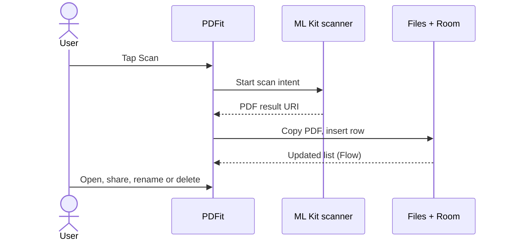
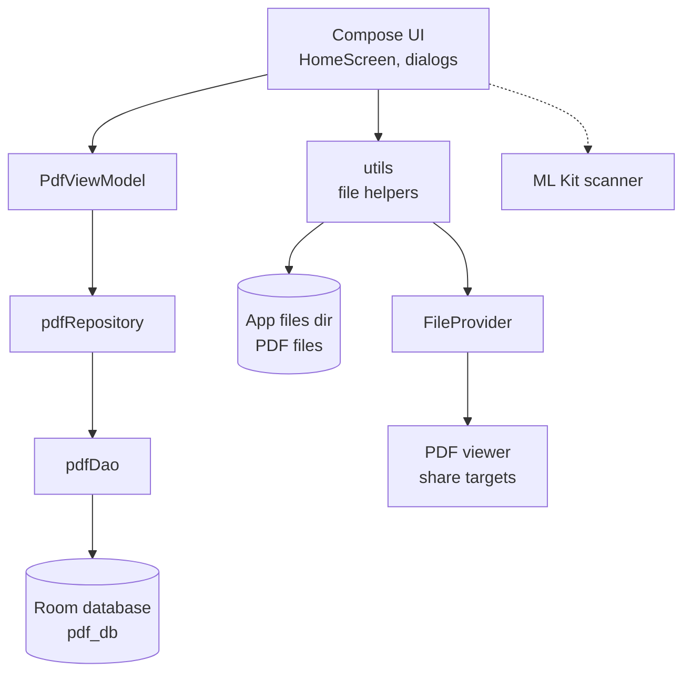

<div align="center">

# PDFit

**Scan a document, get a PDF, keep it on your phone.**

[](https://play.google.com/store/apps/details?id=com.pdfit.scanner)


</div>

## Table of contents

- [Why PDFit](#why-pdfit)
- [How it works](#how-it-works)
- [Features](#features)
- [Tech stack](#tech-stack)
- [Architecture](#architecture)
- [Engineering highlights](#engineering-highlights)
- [Getting started](#getting-started)
- [Testing](#testing)
- [Project structure](#project-structure)
- [Status and roadmap](#status-and-roadmap)
- [Author](#author)

## Why PDFit

Turning photos of paper into a PDF usually means an online converter with ads, page limits or an account, or an app that uploads your documents to a server.

PDFit does the scan on the device and saves the PDF in the app's own private storage. There is no backend, no sign-in and no ads. The app has one screen: a list of your PDFs and a **Scan** button.

## How it works

Tapping **Scan** opens the Google ML Kit document scanner. When you finish, the app copies the PDF into its private storage and records it in a local database. The list screen reads from that database.



## Features

| Feature | What it does |
| --- | --- |
| Document scanning | Uses the ML Kit document scanner in full mode: edge detection, crop and cleanup. |
| Gallery import | Builds a PDF from images already on the phone. |
| PDF output | Saves each scan as a PDF named with the date and time, for example `29-Apr-2026 20:26:19.pdf`. |
| Document list | Shows each PDF with its size and last modified time. |
| Open | Opens the PDF in whichever PDF viewer is installed. |
| Share | Sends the PDF through the Android share sheet. |
| Rename and delete | Renames or deletes the file on disk and updates the list. |
| Dark mode | A switch in the top bar changes the theme. The choice is not saved between launches. |

## Tech stack

| Layer | Technology |
| --- | --- |
| Language | Kotlin 2.0.21 |
| UI | Jetpack Compose (BOM 2024.09.00), Material 3 |
| Scanning | ML Kit Document Scanner through Google Play services (`play-services-mlkit-document-scanner` 16.0.0) |
| Local data | Room 2.8.4 with KSP, Kotlin coroutines and Flow |
| State | `ViewModel` with Compose state and `StateFlow` |
| File sharing | AndroidX `FileProvider` |
| Build | Android Gradle Plugin 9.0.0, Gradle 9.3.1, JDK 21 |
| Targets | `minSdk` 26, `targetSdk` 36, `compileSdk` 36 |

## Architecture

PDFit follows MVVM with a repository. Compose screens observe `PdfViewModel`. The view model talks to `pdfRepository`, which wraps the Room DAO. The PDF files themselves are handled by small helpers in `utils`, which the UI calls directly.



- The PDF file is the document. The Room row (`id`, `name`, `size`, `lastModifiedDate`) is an index that drives the list.
- The list is a `Flow` from Room, so inserts, renames and deletes show up without manual refresh.
- Database calls run on `Dispatchers.IO`.
- Other apps never get a file path. They get a temporary read-only URI from `FileProvider`.

## Engineering highlights

- **No camera permission.** Scanning is delegated to the ML Kit scanner activity provided by Google Play services. The app's manifest declares no `CAMERA` permission and contains no camera code. The trade-off is that the app needs Google Play services.
- **Private storage with scoped sharing.** PDFs live in `filesDir`. The `FileProvider` is `exported="false"` with `grantUriPermissions="true"`, and the open and share intents grant `FLAG_GRANT_READ_URI_PERMISSION` for a single file.
- **Delete checks the file first.** The database row is removed only if `deleteRecursively()` on the file returned `true`. A failed file delete cannot leave the list pointing at nothing.
- **Reactive list, not manual refresh.** `getAllPdfs()` returns a `Flow<List<pdfEntity>>`. The repository applies `flowOn(Dispatchers.IO)`, and the screen collects it as Compose state keyed by row id.
- **Local-only by construction.** The source has no network client, no analytics and no backend. The only external piece is the scanner module that Google Play services provides.

## Getting started

### Prerequisites

- A recent Android Studio that supports Android Gradle Plugin 9.0.0
- Android SDK Platform 36
- JDK 21. The Gradle daemon is configured to use it and downloads it through the Foojay resolver if it is missing.
- An Android device or emulator on API 26 or higher **with Google Play services**, which the scanner needs

### Clone and open

```bash
git clone https://github.com/mahakaal2005/PDFit.git
cd PDFit
```

Open the folder in Android Studio and let it sync. Android Studio writes `local.properties` with your SDK location. If you build from the command line only, set `sdk.dir` in `local.properties` or export `ANDROID_HOME`.

No API keys or other configuration are needed.

### Build and run

```bash
# Build a debug APK (app/build/outputs/apk/debug/app-debug.apk)
./gradlew assembleDebug

# Install on a connected device or running emulator
./gradlew installDebug
```

`./gradlew assembleRelease` builds a release variant. The project has no signing configuration, so the output is unsigned until you add one.

## Testing

```bash
# JVM unit tests
./gradlew testDebugUnitTest

# Instrumented tests (needs a connected device or emulator)
./gradlew connectedDebugAndroidTest
```

The repository currently contains only the two template tests that Android Studio generates. There are no tests for the data layer or UI yet. The template instrumented test also asserts a package name (`com.my.docscannerapp`) that no longer matches the app (`com.pdfit.scanner`), so it fails.

## Project structure

```text
.
├── build.gradle.kts                 # Root plugins (AGP, Compose, KSP)
├── settings.gradle.kts              # Repositories and the :app module
├── gradle/libs.versions.toml        # Version catalog
└── app/
    ├── build.gradle.kts             # App module: SDK levels, dependencies
    └── src/
        ├── main/
        │   ├── AndroidManifest.xml  # Launcher activity and FileProvider
        │   ├── res/xml/filepaths.xml# Paths the FileProvider may expose
        │   └── java/com/pdfit/scanner/
        │       ├── MainActivity.kt  # Splash screen, theme, HomeScreen
        │       ├── data/
        │       │   ├── local/       # Room database, DAO, Date converter
        │       │   ├── models/      # pdfEntity
        │       │   └── repository/  # pdfRepository
        │       ├── ui/
        │       │   ├── screens/     # Home, rename/delete dialog, list item
        │       │   ├── theme/       # Colors, typography, Material theme
        │       │   └── viewmodels/  # PdfViewModel
        │       └── utils/           # File copy, rename, delete, URI helpers
        ├── test/                    # JVM unit tests (template only)
        └── androidTest/             # Instrumented tests (template only)
```

## Status and roadmap

**Current state:** version 1.0 (`versionCode` 1) is [on Google Play](https://play.google.com/store/apps/details?id=com.pdfit.scanner). The scan, open, share, rename and delete flows work.

Known gaps:

- Almost no automated tests (see [Testing](#testing)).
- The dark mode choice is not persisted.
- Renaming does not enforce a `.pdf` extension or check for name clashes.
- Release builds have minification turned off.
- The repository has no `LICENSE` file, so no license is granted yet.

Ideas not built yet:

- OCR text extraction
- Signature support
- Document encryption
- Optional cloud backup

## Author

Atul Kumar Singh. GitHub: [mahakaal2005](https://github.com/mahakaal2005)
